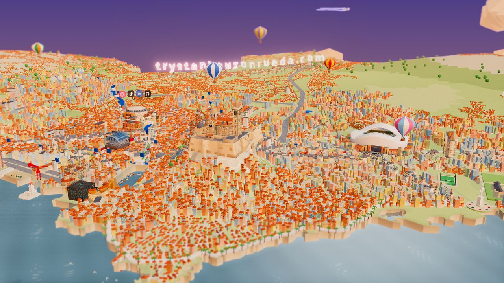
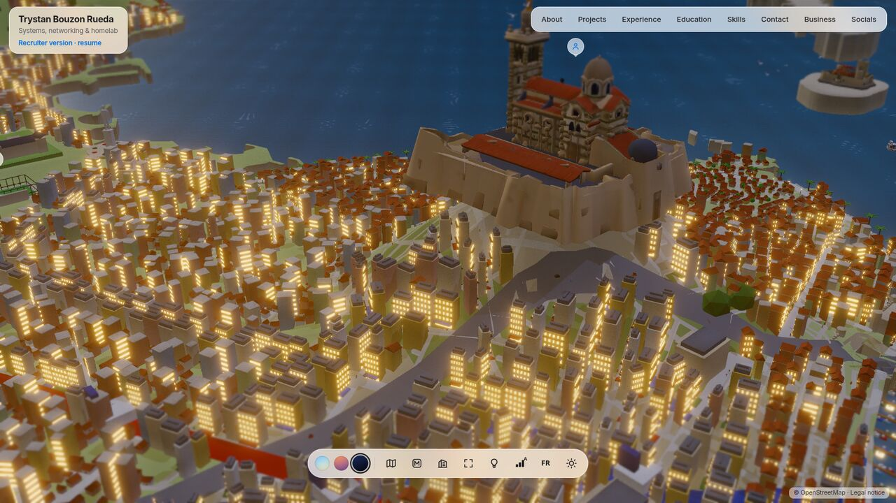
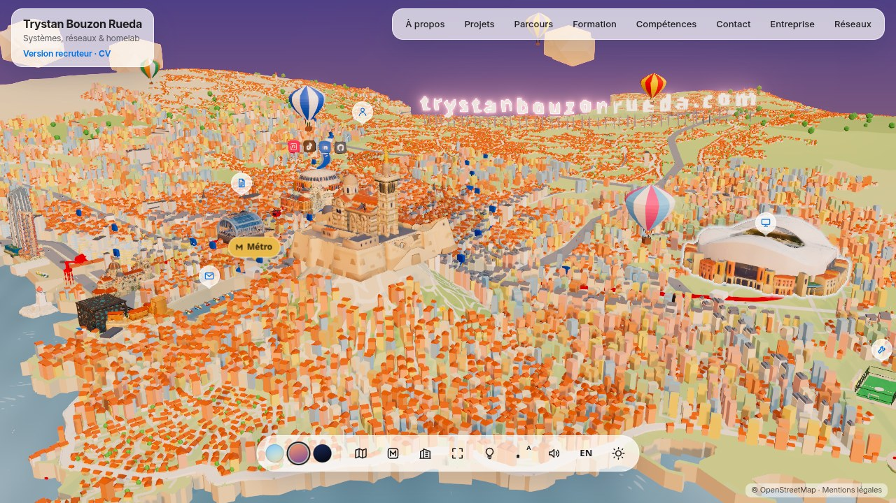
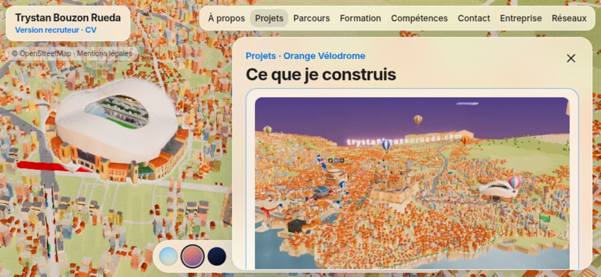

# trystanbouzonrueda.com

My portfolio as a 3D island of **Marseille**, built from OpenStreetMap data and rendered in the browser with Three.js.
Each landmark opens a section: Notre-Dame-de-la-Garde for *About*, the Vélodrome for *Projects*, the Vieux-Port for *Contact*, and so on.
A flying "monument metro" links them, and the city lives on its own: traffic, pedestrians, boats, a Canadair, day/sunset/night cycle.

**Live:** https://trystanbouzonrueda.com · a plain HTML version for recruiters lives at [`/recruteur/`](recruteur/index.html).
The site is bilingual (French / English): it follows your browser language, with a FR/EN switch in the bottom bar.



| Night | Hover | Mobile (landscape) |
|---|---|---|
|  |  |  |

## Stack

- **Three.js** + `postprocessing` (bloom, SMAA), TypeScript, **Vite**
- **Blender** (Python scripts) to turn OpenStreetMap buildings, roads and coastline into a stylised low-poly island
- **Meshy AI** for a few hand-picked landmark models (monuments, boats, props), cleaned up and decimated in Blender
- **glTF-Transform** to compress the exported scenes (meshopt, WebP textures)
- Static site, no cookies. Privacy-friendly, cookieless visit counter (see the legal notice).

## Run it

```bash
npm ci
npm run dev       # http://localhost:5173
npm run build     # type-check + production build in dist/
```

The compressed models in `public/models/` are committed, so the site runs without Blender.

## Layout

```
src/            the site: scene, camera intro, sky, bubbles, metro, traffic, UI
  config.ts     landmarks and the section each one opens
  content.ts    text of every section, in French and English
  i18n.ts       language detection and live FR/EN switch
  son.ts        ambient sound, fully synthesised with Web Audio (no audio files)
  secrets.ts    a few easter eggs (find them!)
  stats.ts      self-hosted, cookieless GoatCounter analytics (production only)
public/         models (.glb), CVs, minimap and simulation data
blender/        Python scripts that build the city in Blender
  osm/          OpenStreetMap fetch, projection and "faithful" city build
  meshy/        prompts and scripts used to generate the landmark models
scripts/        model optimisation, screenshots, perf checks, OG image
recruteur/      plain HTML version   mentions-legales/  legal notice
docs/           screenshots
```

## Rebuilding the city

The `.blend` sources are not in the repo (too heavy). The pipeline, for reference:

1. `blender/osm/fetch.py` downloads the OSM data, `build_fidele.py` builds the base city in Blender.
2. `blender/build_*.py` add the districts, landmarks, port, corniche and props.
3. `npm run city` exports the scene (`blender/export_web.py`), compresses it (`scripts/optimize.mjs`) and rebuilds the minimap.

The Blender scripts find their folder on their own; when one is run through `exec` (Blender MCP), set `PORTFOLIO_BLENDER=/path/to/repo/blender/`.

## Credits

- Map data © [OpenStreetMap](https://www.openstreetmap.org/copyright) contributors, ODbL.
- Landmark models generated with [Meshy](https://www.meshy.ai), then edited.
- [three.js](https://threejs.org), [postprocessing](https://github.com/pmndrs/postprocessing), [glTF-Transform](https://gltf-transform.dev).

## License

Code under the [MIT License](LICENSE). Text content, CVs and personal photos are © Trystan Bouzon Rueda, not covered by the license.
